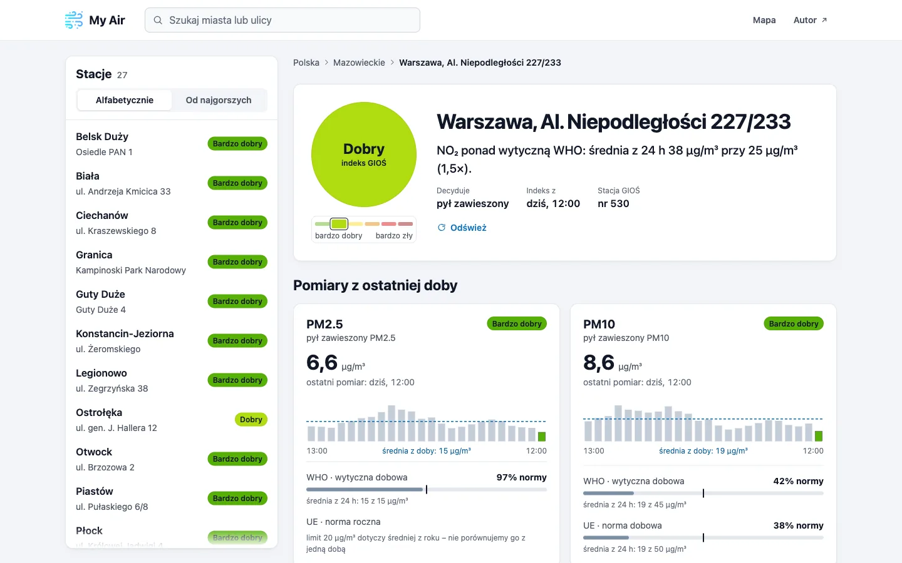
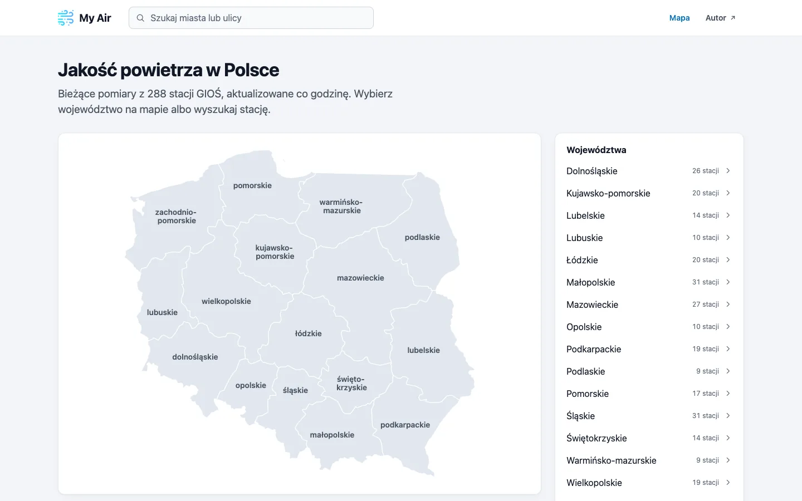
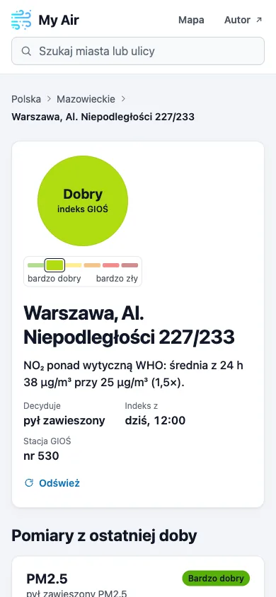

# My Air

Bieżąca jakość powietrza w Polsce prosto z pomiarów GIOŚ: oficjalny indeks dla każdej stacji,
odczyty z ostatniej doby i uczciwe porównanie z normami WHO i UE.

**[myair.puzyna.pl](https://myair.puzyna.pl)** · Angular 22 · Cloudflare Pages · dane:
[GIOŚ](https://powietrze.gios.gov.pl)



<p>
  
  
</p>

<sub>Zrzuty z myair.puzyna.pl na rzeczywistych danych GIOŚ (18.11.2026, godz. 12:00).</sub>

## Co potrafi

- **Mapa → województwo → stacja.** Mapę województw rysujemy z prawdziwych granic. Lista stacji
  pokazuje przy każdej stacji jej indeks GIOŚ i da się ją posortować od najgorszych. Podsumowanie
  województwa pokazuje najgorszy indeks i rozkład poziomów na stacjach.
- **Najpierw odpowiedź, potem liczby.** Widok stacji zaczyna się od indeksu GIOŚ (kolorowy dysk,
  skala sześciu poziomów), wskaźnika, który o nim decyduje, i jednego zdania o normach, np.
  „NO₂ ponad wytyczną WHO: średnia z 24 h 38 µg/m³ przy 25 µg/m³ (1,5×)”.
- **Głośność rośnie z indeksem.** Przy dobrym powietrzu interfejs jest spokojny. Przy
  „Dostatecznym” karta stacji się podbarwia, a przy „Złym” i „Bardzo złym” zalewa ją kolor
  indeksu, a na telefonie także pasek przeglądarki.
- **Karta każdego wskaźnika.** Pokazuje ostatnią wartość dokładnie tak, jak opublikował ją GIOŚ, i
  wykres doby z odczytem godziny (kursor, dotyk lub strzałki). Pod wykresem są mierniki „% normy”
  względem wytycznej WHO i normy UE.
- **Każda stacja ma własny adres**, np. `/wojewodztwo/5/stacja/530`. Wyszukiwarka w nagłówku działa
  także bez polskich znaków („lodz” → Łódź).
- **Telefon i komputer.** Obsługa klawiaturą i czytnikami ekranu: wyszukiwarka jako combobox,
  wykres jako suwak, link „Przejdź do treści”.

## Jak porównujemy z normami

Normę porównujemy wyłącznie w jej własnym okresie uśredniania. Pojedyncza godzina nigdy nie jest
„przekroczeniem” normy dobowej, a norm rocznych nie sprawdzamy danymi z jednej doby. Logika jest w
[src/app/lib/norms.ts](src/app/lib/norms.ts) i ma testy.

| Wskaźnik | WHO 2021 (wytyczne zdrowotne) | UE (normy obowiązujące w Polsce) |
| -------- | ----------------------------- | -------------------------------- |
| PM2.5    | 15 µg/m³, doba                | 20 µg/m³, rok (bez porównania)   |
| PM10     | 45 µg/m³, doba                | 50 µg/m³, doba                   |
| NO₂      | 25 µg/m³, doba                | 200 µg/m³, godzina               |
| O₃       | 100 µg/m³, 8 h                | 120 µg/m³, 8 h (poziom docelowy) |
| SO₂      | 40 µg/m³, doba                | 125 µg/m³, doba                  |
| CO       | 4 mg/m³, doba                 | 10 mg/m³, 8 h                    |
| benzen   | –                             | 5 µg/m³, rok (bez porównania)    |

- **Doba:** średnia z ostatnich 24 godzin. Liczymy ją tylko, gdy jest co najmniej 18 pomiarów.
- **8 h:** najwyższa średnia krocząca z 8 godzin w ostatniej dobie, przy co najmniej 6 pomiarach w
  oknie.
- **Godzina:** ostatnia godzina z pomiarem.

Indeks i jego kolory pochodzą wprost z GIOŚ (Polski Indeks Jakości Powietrza, endpoint
`aqindex/getIndex`). Aplikacja niczego tu nie przelicza.

## Jak to działa

API GIOŚ wpuszcza przez CORS tylko własną domenę. Dlatego przeglądarka woła wyłącznie `/api/...`
(stała `API_BASE_URL` w [src/app/api.config.ts](src/app/api.config.ts)), a zapytania dalej
przekazuje:

| Środowisko                           | Co obsługuje `/api/*`                                                 |
| ------------------------------------ | --------------------------------------------------------------------- |
| `npm start` (`ng serve`)             | [proxy.conf.json](proxy.conf.json)                                    |
| Cloudflare Pages / `npm run preview` | Pages Function [functions/api/[[path]].js](functions/api/[[path]].js) |

Pages Function:

- przyjmuje tylko GET/HEAD (inne → 405) i dokleja ścieżkę oraz query do
  `https://api.gios.gov.pl/pjp-api/v1/rest/`; nie da się nią wyjść poza ten adres (→ 400),
- trzyma odpowiedzi w Cache API przez 10 minut (nagłówek `X-Proxy-Cache: HIT|MISS`),
- po 10 s bez odpowiedzi GIOŚ zwraca 504, przy błędzie połączenia 502 (krótki JSON),
- przepuszcza status i `Content-Type`, bez `Set-Cookie` i `Access-Control-Allow-Origin`.

Nagłówki plików statycznych (cache, bezpieczeństwo) są w [public/_headers](public/_headers).
Brak `404.html` w wyniku builda włącza na Pages tryb SPA (każda nieznana ścieżka → `index.html`).

Aplikacja nie używa bibliotek UI ani zewnętrznych fontów: komponenty są własne, krój systemowy, a
ikony to rysowane SVG. Zasady wyglądu opisuje [DESIGN.md](DESIGN.md), a założenia produktu
[PRODUCT.md](PRODUCT.md).

## Struktura

```
src/app/
  home/                  mapa województw (SVG) i lista województw
  voivodeship/           lista stacji z indeksem GIOŚ i sortowaniem
  voivodeship-summary/   podsumowanie województwa
  station/               widok stacji, karty wskaźników, wykres i mierniki norm
  search/                wyszukiwarka stacji (combobox)
  lib/norms.ts           normy WHO/UE i porównania w okresach uśredniania
  voivodeship.service.ts klient API GIOŚ (stacje, stanowiska, pomiary, indeks)
functions/               Pages Function: proxy do API GIOŚ
scripts/                 generator granic województw do mapy
```

## Komendy

Wymagany Node.js w wersji z [.nvmrc](.nvmrc) (`nvm use`).

| Komenda                  | Opis                                                                          |
| ------------------------ | ----------------------------------------------------------------------------- |
| `npm start`              | dev server na http://localhost:4200 z proxy do GIOŚ                           |
| `npm run build`          | build produkcyjny do `dist/my-air/browser`                                    |
| `npm test`               | testy jednostkowe (Vitest): normy, formatowanie, serwis API, komponenty       |
| `npm run test:functions` | testy Pages Function (`node --test`)                                          |
| `npm run preview`        | build + `wrangler pages dev` na http://localhost:8788 (jak na Pages, z proxy) |

Granice województw w [src/app/data/voivodeship-shapes.ts](src/app/data/voivodeship-shapes.ts) są
wygenerowane skryptem [scripts/voivodeship-map.py](scripts/voivodeship-map.py) (Python, bez
zależności). Instrukcja ponownego wygenerowania jest w nagłówku skryptu.

## Deploy (Cloudflare Pages)

Produkcja: https://myair.puzyna.pl/ (link z portfolio https://puzyna.pl). Pages buduje projekt z
GitHuba po każdym pushu:

- production branch: `master` (inne gałęzie dostają podgląd na `*.pages.dev`),
- framework preset: **None**,
- build command: `npm run build`,
- build output directory: `dist/my-air/browser`,
- wersja Node z `.nvmrc` (zmienna `NODE_VERSION` nie jest potrzebna).

Projekt Pages zakłada się przez **Workers & Pages → Create → „Looking to deploy Pages? Get
started” → Import an existing Git repository** (nie formularz Workers z `npx wrangler deploy`).
Domena: projekt → **Custom domains → Set up a custom domain** → `myair.puzyna.pl`. Strefa
`puzyna.pl` jest w tym samym koncie Cloudflare, więc rekord CNAME Pages dodaje sam.

## Dane i źródła

- **Pomiary i indeks:** [Główny Inspektorat Ochrony Środowiska](https://powietrze.gios.gov.pl),
  API v1. Kolory poziomów indeksu pochodzą z legendy na powietrze.gios.gov.pl.
- **Normy:** wytyczne WHO z 2021 r. (WHO Global Air Quality Guidelines) i dyrektywa 2008/50/WE w
  brzmieniu obowiązującym w Polsce.
- **Granice województw:** [Natural Earth](https://www.naturalearthdata.com), 1:10m Admin 1
  (domena publiczna).

## In English

My Air shows current air quality in Poland from the official GIOŚ monitoring network. Every
station shows the official Polish Air Quality Index, its last 24 hours of hourly readings and a
comparison with the WHO 2021 guidelines and the EU limits. Each norm is checked only over its own
averaging period. The app is built with Angular 22 (standalone, zoneless, no UI library) and runs
on Cloudflare Pages. A small Pages Function proxies the GIOŚ API, which only allows its own origin
over CORS. The interface is in Polish. Live: [myair.puzyna.pl](https://myair.puzyna.pl).
